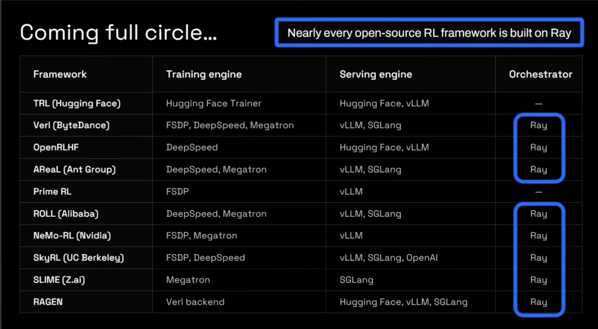

# What is Ray? Why is Ray?

從 UC Berkeley RISELab，到今天的 production AI tech stack

---

# 一、AI workload 越來越複雜

---

# 一個 AI 服務背後有哪些事情要做？

| 工作 | 長什麼樣 | 需要什麼硬體 |
|---|---|---|
| 資料處理 | 讀幾 TB 的檔案、清理、轉換、產生特徵 | 很多台 CPU 機器 |
| 模型訓練 | 一個 training job 切到很多張 GPU 上跑，每一步都要交換結果 | 好幾張 GPU，而且要放在同一台或網路很快的機器上 |
| 批次推論 | 把訓練好的模型跑過整個資料集 | CPU 前處理加 GPU 推論 |
| 線上服務 | 接收請求，幾十毫秒內回應 | 常駐的 GPU，流量大時要擴充 |
| 強化學習 | 模擬、訓練、推論在同一個迴圈裡輪流進行 | 以上全部：CPU 做模擬、GPU 做訓練、常駐的程式做推論 |
| 後訓練 | 拿預訓練好的模型做 SFT、RL 等對齊訓練；RL 階段 inference 和更新模型輪流進行 | GPU，RL 階段還要同時跑推論引擎（跑 inference）和訓練框架（更新模型） |

---

# 不同的工作，相同的難題

每一種工作都要自己面對同一組分散式系統的問題：

- **排程（scheduling）**：這個任務該在哪台機器跑？GPU 給誰？
- **容錯（fault tolerance）**：一台機器掛了，整個工作要重來嗎？
- **資料搬運**：這台機器算出來的結果，怎麼交給另一台？
- **擴展**：工作量變大時，怎麼多開機器？工作結束後，怎麼把機器釋放掉（costdown）？

這些問題和模型本身無關，但每個團隊都得重複造輪子。

---

# 2016 年的解法：每種工作一套系統

| 工作 | 當時用的系統 |
|---|---|
| 資料處理 | Apache Spark、Hadoop |
| 分散式訓練 | MPI、參數伺服器、Horovod |
| 線上服務 | 網頁框架加 load balancer |
| 強化學習的模擬 | 自己寫一個 task queue，把模擬分給很多台機器 |

每套系統只擅長一種計算。一個產品要用到三、四套，下一頁看一個例子。

---

# 例子：2016 年做一個推薦模型

| 步驟 | 用什麼 | 接縫處要自己寫什麼 |
|---|---|---|
| 1. 從點擊紀錄算特徵 | Spark 跑在 Hadoop 叢集，CPU 機器 | 結果寫成 Parquet 檔到 HDFS |
| 2. 把特徵搬到 GPU 機器 | Python 腳本 | Parquet 轉成訓練框架要的格式，`scp` 到 4 台 GPU 機器 |
| 3. 訓練 | `mpirun` 啟動 4 台機器上的 Horovod | 一台掛了整個訓練中止，自己寫 checkpoint 和重跑 |
| 4. 批次算全站使用者的推薦 | Spark 的機器沒有 GPU | 自己寫迴圈把資料切塊、輪流丟到 GPU 機器，失敗的自己補跑 |
| 5. 上線 | 模型檔複製到服務機器，Flask 包起來，前面放 load balancer | 流量變大時手動加機器 |

- **膠水程式碼**：每換一套工具就要轉一次格式。Spark 吐出來的是 Parquet，Horovod 要吃的是另一種格式，中間那段轉換的 code 沒人想維護，但上游欄位一改它就壞
- **掛掉的處理方式都不一樣**：Spark 的 task 掛了它自己會重試；MPI 掛一台，整個訓練從頭來；Flask 掛了要靠外面的監控把它拉起來。同一條 pipeline 要維護三種不同的容錯機制

> 問題不是「沒有分散式系統」，而是「每種 workload 都要維護一套」。

---

# 二、Ray 一開始是為了強化學習

---

# UC Berkeley RISELab，2016 年

- RISELab 的前身 AMPLab 做出了 Apache Spark
- Spark 的共同創辦人 Ion Stoica，和兩位博士生 Philipp Moritz、Robert Nishihara，當時在做強化學習（RL）
- 2018 年在系統領域頂尖的研討會 OSDI 發表論文〈Ray: A Distributed Framework for Emerging AI Applications〉

他們遇到的，就是上一章那些問題的極端版。

---

# 強化學習：一個程式裡有三種完全不同的計算

一個 RL 應用（例如讓機器手臂學抓東西、讓程式玩 Atari）的迴圈：

| 步驟 | 長什麼樣 |
|---|---|
| 模擬：讓程式在環境裡動作（例如玩一局遊戲），收集結果 | 上萬個又短又小的 CPU 任務，數量事先不知道 |
| 訓練：用收集到的結果更新模型 | 少量但很重的 GPU 任務，多張 GPU 之間要同步 |
| 推論：模型決定下一步要做什麼 | 幾毫秒內要給出結果，而且要記住目前的狀態 |

這三種計算在**同一個迴圈裡**不斷交替。用 Spark 做模擬太慢，因為 Spark 的任務以秒計，模擬的任務以毫秒計；用 MPI 不夠彈性，因為 MPI 要事先知道有幾個任務、跑在哪裡。把三套系統拼起來，資料在系統之間搬運的時間有時比計算還久。

<!--
重點：RL 不是「一種新 workload」，而是把六種 workload 的問題壓縮進同一個程式。所以解了 RL 的問題，就順便解了其他的。
-->

---

# 三、Ray 怎麼解決

---

# 不分系統種類，只給兩種 building block

Ray 的初衷：不做「資料系統」或「訓練系統」，只做一件事，**讓任何 Python function 或 class 可以在一整個叢集上執行**。

```python
@ray.remote
def simulate(seed):          # 加一個 decorator，這個 function 就能在叢集任何一台機器上跑
    ...

@ray.remote(num_gpus=1)
class Trainer:               # class 也可以，而且可以說「我需要一張 GPU」
    def train(self, data): ...

results = [simulate.remote(s) for s in range(10000)]   # 一萬個任務平行跑
trainer = Trainer.remote()
trainer.train.remote(results)                          # 結果直接交給 GPU 上的 Actor
```

- function 加上 `@ray.remote` 就是 **Task**，class 加上 `@ray.remote` 就是 **Actor**，這是 Ray 僅有的兩種 building block
- 排程、容錯、資料在機器間搬運、自動擴展，只要設定好，其他全部由 Ray 處理

---

# 為什麼這樣就夠了

| 上一章的難題 | Ray 的做法 |
|---|---|
| 這個任務該在哪台機器跑 | 任務宣告自己要幾顆 CPU、幾張 GPU，Ray 找有資源的機器 |
| 一台機器掛了怎麼辦 | Ray 記得每個任務的輸入是什麼，掛掉的任務可以在別台機器重跑一次 |
| 結果怎麼交給另一台 | 結果放在每台機器上共用的記憶體區（object store），傳給下一個 Task 時只傳一個 reference，不複製資料；只有跨機器時才真的搬 |
| 工作量變大怎麼辦 | 叢集自動多開機器，閒下來自動關掉 |

模擬、訓練、推論三種計算在同一個程式、同一個叢集裡，中間不用再寫膠水。

> **Ray 解決的不是「怎麼算」，是「誰在哪台機器算、資料怎麼送到那裡」。** 計算本身交給 PyTorch、JAX、vLLM 這些框架。

---

# 四、因為很彈性，所以擴展到其他情境

---

# Ray 的函式庫：都是用 Task 和 Actor 拼出來的

有了generial 的 building blocks tasks & actors, 我們可以利用他們做出更貼近常見應用的libraries:

| 函式庫 | 解決的 workload | 怎麼拼 |
|---|---|---|
| Ray Data | 資料處理、批次推論 | 讀檔和轉換是 Task；載入模型跑 inference 的是 Actor；資料切成小塊，一塊一塊送進 GPU |
| Ray Train | 分散式訓練 | 每張 GPU 一個 Actor，Ray 幫它們建好 process group，計算交給 PyTorch |
| Ray Serve | 線上服務 | 每個模型一個 replica、每個 replica 一個 Actor，自動擴展、多模型組合 |
| SkyRL | 強化學習 | 第二章那個模擬、訓練、推論的迴圈 |

加上 **KubeRay**：在 Kubernetes 上建立、擴展 Ray 叢集的工具。

---

# Ray 的成長

| 時間 | 事件 |
|---|---|
| 2016 | RISELab 開始開發 |
| 2018 | OSDI 論文；Tune、RLlib 出現 |
| 2019.12 | 作者成立 Anyscale |
| 2020.9 | Ray 1.0，API 穩定 |
| 2022.8 | Ray 2.0，Data、Train、Tune、Serve 整合 |
| 2025.10 | 加入 PyTorch Foundation；累計下載 2.37 億次 |
| 2026.11 | KubeRay 捐贈 CNCF |

---

# 五、大公司都拿 Ray 做什麼

---

# 讀案例前：四種角色

| 角色 | Ray 在做什麼 | 案例 |
|---|---|---|
| 分散式訓練的骨幹 | 把一個 training job 切到上百上千張 GPU | OpenAI、Uber |
| 資料處理與批次推論 | 把資料持續餵進 GPU，把模型批次跑過整個資料集 | Amazon、Pinterest |
| 線上服務 | 把 Python 或 Java 程式變成可擴展的服務 | Ant Group |
| ML 平台的基礎 | 公司內部所有人共用的一套 infra | Spotify、Uber |

---

# OpenAI：從自己拼湊的 MPI 系統，換成 Ray train 出了 GPT3

- OpenAI 早期的訓練基礎設施是自己用 MPI 拼出來的
- 模型愈訓愈大，自己維護這套東西愈來愈吃力，於是改用 Ray
- Ray 接手了分散式的排程和協調，OpenAI 的工程師不必再自己處理這些，可以把時間放在模型上
- 結果：用 Ray 訓練它最大的模型，包括 ChatGPT 背後的模型
- OpenAI President and Co-founder Greg Brockman: "Large model training is where it really started, but we’ve seen it really spiral out to other applications, like data processing and scheduling across multiple machines, and it’s really convenient to just run that on top of Ray, and not have to think very hard"

**OpenAI 要的不是某個功能，是不用自己維護一套分散式系統。** 就是第三章講的那件事：Ray 管分散式那一層，計算本身還是他們自己的。

---

# Uber：幾百個 Ray 叢集跑在 Kubernetes 上

Uber 的 ML 平台 Michelangelo，2023 到 2024 年把所有 training job 搬到 Kubernetes 上的 Ray：

- 同時有**幾百個** Ray 叢集，每個 training job 一個
- Kubernetes 管「很多工作之間」怎麼分 GPU，Ray 管「一個 training job 內部」怎麼把計算分到拿到的 GPU 上
- 訓練程式只說「我要 16 張 GPU」，Ray 負責啟動 16 個 worker、建好它們之間的通訊
- 搬過去之後訓練速度提升 1.5 到 4 倍

2025 年 Uber 工程總監：「Ray 已經是 Uber AI 平台的核心，支撐大規模模型訓練和分散式資料處理。」

---

# Amazon：EB 等級的資料處理，從 Spark 搬到 Ray

Amazon 零售的資料團隊有一個背景工作叫 compaction：上游資料庫每一筆新增和修改都會寫成變更紀錄存到 S3，compaction 定期把這些變更合併回正本資料表。2019 年資料長到 EB（exabyte）級，原本用 Spark 寫的 compaction 跟不上：最大的表要手動調整參數，還常常超過時限。

2020 年用 Ray 重寫，先挑最大的約 1% 資料表（占 Spark compaction 成本的 40%），Spark 和 Ray 同時跑、確認結果一樣之後才一張一張切過去。2024 年第一季的規模：

| | |
|---|---|
| 每天的量 | 讀入超過 20 PiB 的資料，跑超過 1,600 個 Ray job |
| 相較於 Spark | 同樣的機器處理同樣的資料，成本效率好 82%；以一般 EC2 客戶的價格換算，一年省超過 1.2 億美元 |

---

# Pinterest：讓 GPU 不要等資料

Pinterest 的問題不是規模，是**迭代速度**。原本 Spark 先把資料集完整寫出來，再交給 PyTorch 訓練，從改一次資料到看到模型結果要 90 小時。

改用 Ray Data 後，資料處理和訓練在同一個程式裡，CPU 機器一邊轉換、一邊串流餵給 GPU：

| 一次實驗的時間 | 訓練成本 | GPU 利用率 |
|---|---|---|
| 90 → 15 小時 | 省 25% | 超過 90% |

同一套架構拿來做批次推論（2024 年）：吞吐量提升 4.5 倍；搜尋品質團隊有一個 inference job 從 Spark 搬到 Ray 之後，一年的成本降到三十分之一。

GPU 很貴，訓練時 GPU 常常在等資料。Ray 可以在同一個工作裡要求「50 台 CPU 機器做轉換、8 張 GPU 做訓練」，讓便宜的 CPU 去餵貴的 GPU。

---

# Ant Group：雙十一的 137 萬 TPS

螞蟻集團（支付寶）2018 年前後開始用 Ray，後來用它蓋了線上服務平台 Ant Ray Serving：

- 2022 年雙十一：跑模型服務的機器共 24 萬顆 CPU 核心，尖峰每秒處理 137 萬筆請求（TPS）
- 用途：模型推論、線上資源分配（作業研究的最佳化問題）、支付／金融／保險的 serverless 計算
- 服務平台本身也是用 Actor 蓋的：負責路由的、跑模型的 replica、管跨叢集流量的，都是 Actor

---

# Samsara：把一條推論管線放進一個程式

Samsara 做 AI 行車記錄器，雲端每天處理數百萬個請求，每個請求經過多個電腦視覺模型。

- 原本：多個微服務、多個團隊、多種框架，發布一個新模型要跨團隊協調
- 改用 Ray Serve：整條 pipeline 寫在一個 Python 程式裡，每個模型各自設定要幾個 replica、用多少 GPU，流量變了各自增減
- 推論成本一年減少約 50%

---

# Spotify：公司內部共用的一套 Ray

Spotify 原本的 ML 平台以 TensorFlow 和 Kubeflow 為中心，服務超過一半的內部使用者，但研究人員要用 PyTorch、圖神經網路時，拿不到 GPU 和分散式資源。

2023 年公開的 Spotify-Ray：

- 建在 GKE 和開源的 KubeRay 上，使用者說要幾顆 CPU、幾張 GPU，平台負責建叢集、把不同團隊隔開、提供監控
- 研究團隊用它做推薦系統的圖神經網路，不到三個月上線 A/B 測試

這是第四種角色：Ray 不是某一個工作的工具，是整間公司 ML 平台底下共用的那一層。Uber、Pinterest 也是這樣用。

---

# 六、回到起點：RL 框架

---

# 2024 年之後最熱門的 workload，又是強化學習

ChatGPT 之後的 RLHF、DeepSeek-R1 之後的 RLVR，都是用強化學習做 LLM 的後訓練：

1. **生成**：模型對一批 prompt 跑 inference，產生 output（用 vLLM 這類推論引擎）
2. **評分**：reward model 或規則判斷 output 好不好
3. **更新**：用 PPO、GRPO 更新模型（用 FSDP、Megatron 這類訓練框架）
4. 把更新後的 weights 同步回推論引擎，回到第 1 步

和 2017 年一樣：**一個程式裡同時有模擬（生成）、訓練、推論**，只是環境從 Atari 變成數學題和程式碼，而且迴圈裡的每個模型都要占數十到數千張 GPU。

---

# 幾乎每個開源 RL 框架都建在 Ray 上



來源：Anyscale 簡報。訓練引擎和推論引擎各家不同，負責把它們串起來的 orchestrator 幾乎都是 Ray。

---

# 為什麼是 Ray

- 跑 inference 和更新模型用的是不同的引擎，同一個模型在兩個階段切到 GPU 上的方式不一樣，中間還有 reward、critic 這些模型要各自放 GPU
- 這正是 Ray 的工作：**誰在哪些 GPU 上、資料和 weights 怎麼在它們之間傳**，計算本身交給引擎
- verl 的論文〈HybridFlow〉（EuroSys 2025）：吞吐量是既有系統的 1.53 到 20.57 倍

---

# 七、今天的 production AI tech stack 長怎樣

---

# 一間做 AI 產品的公司，2026 年

假設一間公司要做一個客服助理：先整理歷史對話，拿一個開源模型用 RL 做後訓練，最後上線服務。

| 階段 | 用什麼 | Ray 在哪裡 |
|---|---|---|
| 整理資料 | Ray Data 讀 S3 上幾 TB 的對話紀錄，過濾、去除重複、用 LLM 批次標註 | Task 做轉換、Actor 載入模型 |
| 後訓練 | verl 這類 RL 框架：用 vLLM 推論、用 FSDP 更新模型 | 把推論引擎和訓練框架串起來 |
| 上線 | Ray Serve 加 vLLM，流量大時自動加 replica | 每個 replica 一個 Actor |
| 底下 | Kubernetes 管機器，KubeRay 建 Ray 叢集 | |

每個階段的計算交給 FSDP、vLLM；每個階段的分散、排程、容錯交給 Ray；機器交給 Kubernetes。

---

# 疊起來看

```text
應用：資料處理 ── 預訓練／後訓練 ── 推論服務
                      │
  PyTorch（模型）    vLLM（推論引擎）    Ray（分散式執行：Data / Train / Serve）
                      │
             KubeRay（在 Kubernetes 上建 Ray 叢集）
                      │
             Kubernetes（機器與資源分配）
```

- 2025 年 10 月 Ray 加入 PyTorch Foundation，基金會的說法：PyTorch 負責模型、vLLM 負責推論、Ray 負責分散式執行
- 2026 年 11 月 KubeRay 進 CNCF，從 Kubernetes 到 PyTorch 整個堆疊都在 Linux Foundation 之下

Ray 做的事和 2017 年一樣：讓一個 Python 程式，能同時用到一整個叢集裡各種不同的機器。

---

# 延伸閱讀與資料來源

- Moritz 等，*Ray: A Distributed Framework for Emerging AI Applications*（OSDI 2018）
- 陳楷訓，《全世界都在使用的 AI infra 開源專案：Ray / KubeRay》（Medium）
- OpenAI：Anyscale，*Ray Summit 2022 stories: Large language models*
- Uber：*Uber's Journey to Ray on Kubernetes*（2025）
- Amazon：AWS Open Source Blog，*Amazon's Exabyte-Scale Migration from Apache Spark to Ray*（2024）
- Pinterest：*Last-mile Data Processing with Ray*（2023）、*Ray Batch Inference at Pinterest (Part 3)*（2024）
- Ant Group：Anyscale blog（2021、2022）；Samsara：*Building a Modern ML Platform with Ray*（2023）
- Spotify：*Unleashing ML Innovation at Spotify with Ray*（2023）；Canva：Anyscale 客戶案例
- verl：*HybridFlow*（EuroSys 2025）；OpenRLHF（arXiv 2405.11143）
- PyTorch Foundation（2025）、*Donating KubeRay to the CNCF*（2026）

